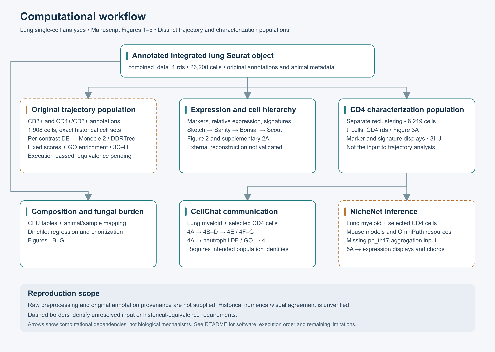

# Checkpoint blockade rewires lung immunity to promote Th17-driven antifungal defense during Paracoccidioides infection

<p>Sandra Marcia Muxel*¹˒², Dennyson Leandro M. Fonseca*¹, Ian Antunes Ferreira Bahia*¹˒², Patrick da Silva³, Leonardo Mandu-Gonçalves²˒⁴, Emanuella Sarmento², Jonathan Miguel Zanatta¹˒², Clara Andrade Teixeira¹˒², Kathia Terumi Kato¹˒², Manoela Osorio Reis Sales¹, Carlos Neandro Cordeiro Lima¹˒², Bruno Prado Eleuterio¹, Luciana dos Santos Barros Manhães²˒⁵, Bernardo de Castro Oliveira², Nycolas Willian Preite⁸, Bruno Montanari Borges⁶, Valeria de Lima Kaminski⁸, Marina Caçador Ayupe², Bianca Vieira dos Santos⁸, Maria Regina D'Império Lima²˒⁵, Denise Morais da Fonseca⁴˒⁶˒⁷, Flavio Vieira Loures⁸, Vera Lúcia Garcia Calich⁹.</p>

Author order, affiliation indices and asterisks are reproduced as supplied. Affiliations and the meaning of the asterisks have not been supplied.

Code and supporting documentation for a manuscript intended for submission to iScience. Publication and acceptance status are not asserted.

## Abstract

Pulmonary paracoccidioidomycosis (PCM) relies on a regulated balance between effector and regulatory immune responses that determine fungal control and lung tissue integrity. Although immune checkpoint pathways shape T-cell responses during chronic inflammation, their role in antifungal immunity remains unclear. Here, we demonstrate that blocking CTLA-4 and PD-1 reshapes the pulmonary immune landscape and enhances fungal control. RNA sequencing of lung cells from infected mice revealed that checkpoint inhibition reshaped the CD4+ T cell compartment into a Th17-enriched state, while simultaneously reducing IL-10-expressing regulatory T cells. This shift was accompanied by the expansion and activation of neutrophils and macrophages expressing inflammatory mediators, including TNF, CCL chemokines, leukocyte-secreted protease inhibitor, and IL-15. Ligand-receptor interactions and trajectory analyses revealed a reinforced communication axis linking Th17-like cells to myeloid populations, particularly under CTLA-4 blockade, converging on IL-17-centered inflammatory signaling networks. Together, these findings reveal a Th17-myeloid circuit that strengthens the host’s antifungal defense.

## Keywords

Paracoccidioidomycosis; immune checkpoint blockade; Th17 cells; antifungal immunity; single-cell RNA sequencing; myeloid cell communication.

## Overview

This repository contains the figure-based lung single-cell RNA sequencing and fungal colony-forming unit analyses for the manuscript. Experimental groups are `naive`, `pbs`, `igg`, `antipd1` and `antictla4`. Analyses include animal-level composition, expression signatures, CD4 characterization, Monocle 2 pseudotime, GO enrichment, CellChat and NicheNet.

Reproduction begins with processed, annotated Seurat objects. Raw-data alignment, upstream QC/integration and original annotation workflows are not supplied. See the [script inventory](docs/SCRIPT_INVENTORY.md), [data guide](data/README.md) and [software requirements](docs/SOFTWARE_REQUIREMENTS.md).

## Computational workflow



Editable [SVG](figures/computational_workflow.svg) and high-resolution [PNG](figures/computational_workflow.png). Arrows show computational dependencies, not biological causation.

The integrated lung input has two distinct downstream populations:

- **Trajectory population: 1,908 cells**, selected directly from `data/combined_data_1.rds` using the original `subtype_cell` annotations `T cells CD3+` (123 cells) and `T cells CD4+/CD3+` (1,785 cells). The cell identifiers match all four historical CDS objects exactly. This is the input to Figure 3C and fixed-signature trajectory scoring.
- **CD4 characterization population: 6,219 cells**, stored in `data/t_cells_CD4.rds` and produced by the separate reclustering workflow in Figure 3A. It supports CD4 characterization, including Figures 3I/J, and the selections used by communication analyses. It is not the trajectory input.

## Repository structure

```text
.
├── README.md
├── .gitignore
├── code/
│   ├── Figure_1/
│   ├── Figure_2/                  # includes Sanity/Bonsai stages
│   ├── Figure_3/
│   ├── Figure_4/
│   └── Figure_5/
├── config/pipeline.env.example
├── data/README.md                 # scientific inputs retained locally
├── docs/
│   ├── FIGURE_MAPPING.md
│   ├── SCRIPT_INVENTORY.md
│   └── SOFTWARE_REQUIREMENTS.md
├── figures/                       # workflow SVG and PNG
├── functions/                     # shared helpers and Monocle 2 patches
└── scripts/                       # smoke tests and validation utilities
```

| Directory | Purpose |
|---|---|
| [code](code/) | All original figure analysis scripts |
| [functions](functions/) | Shared functions, signatures, population loader and compatibility patches |
| [config](config/pipeline.env.example) | Sanity/Bonsai configuration template; private local configuration is ignored |
| [data](data/README.md) | Input contracts, processed data and scientific resources |
| [docs](docs/SCRIPT_INVENTORY.md) | Public figure, execution and software documentation |
| [figures](figures/) | Computational workflow artwork |
| [scripts](scripts/) | Reusable validation and smoke tests |

## What generates each figure

| Figure panel | Script | Analysis | Required inputs | Main outputs |
|---|---|---|---|---|
| 1B | [code/Figure_1/figure_1B/code.r](code/Figure_1/figure_1B/code.r) | CFU group linear model and estimated marginal means | combined_data_1.rds; CFU/cfu_exp1.csv; CFU/mapping_exp1.csv | forestplot.tiff |
| 1C | [code/Figure_1/figure_1C/code.r](code/Figure_1/figure_1C/code.r) | Annotated lung-cell UMAP | combined_data_1.rds | Figure1B_UMAP_600dpi.tiff |
| 1D | [code/Figure_1/figure_1D/code.r](code/Figure_1/figure_1D/code.r) | Animal-level composition and Dirichlet regression | combined_data_1.rds | heatmap_dirichlet.tiff |
| 1E–F | [code/Figure_1/Figure_1E_and_1F/code.r](code/Figure_1/Figure_1E_and_1F/code.r) | Treatment-specific cellular prioritization from abundance | combined_data_1.rds; CFU/cfu_exp1.csv (loaded) | cellular_prioritization_antictla4.tiff; cellular_prioritization_antipd1.tiff (under results/figure1_audit) |
| 1G | [code/Figure_1/Figure_1G/code.r](code/Figure_1/Figure_1G/code.r) | Cluster count fold changes and CFU association | combined_data_1.rds; CFU/mapping_exp1.csv; CFU/cfu_exp1.csv | barplot_logFC.tiff; pro_cell.tiff (under results/figure1_audit) |
| 2B | [code/Figure_2/figure_2b/code.r](code/Figure_2/figure_2b/code.r) | Cell-type marker dot plot | combined_data_1.rds | Figure2_DotPlot_BonsaiColors.tiff |
| 2C input | [code/Figure_2/figure_2C/export_mtx/code_sketch.r](code/Figure_2/figure_2C/export_mtx/code_sketch.r) | 5,000-cell leverage-score sketch | combined_data_1.rds | sketched_data_1.rds |
| 2C input | [code/Figure_2/figure_2C/export_mtx/export.r](code/Figure_2/figure_2C/export_mtx/export.r) | Export sparse counts, identifiers and metadata | sketched_data_1.rds | data/input/{matrix.mtx, genes.tsv, cells.tsv, cell_metadata.csv} |
| 2D–E | [code/Figure_2/figure_2D-E/code.r](code/Figure_2/figure_2D-E/code.r) | Sample-averaged relative-expression ternary plots | combined_data_1.rds | Ternary_Naive_PBS_PD1.tiff; Ternary_Naive_PBS_CTLA4.tiff |
| 2F | [code/Figure_2/figure_2F/code.r](code/Figure_2/figure_2F/code.r) | Animal-averaged T-cell module scores; Kruskal–Wallis and Dunn tests | combined_data_1.rds | Figure2_Tcell_ModuleScores_Dunn.tiff |
| Supplementary 2A | [code/Figure_2/supp_figure_2A/code.r](code/Figure_2/supp_figure_2A/code.r) | Marker heatmap, ternary-gene dot plots and cell-class scores | combined_data_1.rds; session top_vertex_genes | Figure2A_UMAP_600dpi.tiff |
| 3A | [code/Figure_3/figure_3A/code.r](code/Figure_3/figure_3A/code.r) | T-cell selection, CD4 reclustering and UMAP | combined_data_1.rds | DIMT_supp_per group.tiff; ./data/t_cells_CD4.rds; DIMT.tiff |
| 3C | [code/Figure_3/figure_3C/code.r](code/Figure_3/figure_3C/code.r) | Annotation-selected 1,908-cell population; contrast-specific DE ordering and DDRTree | data/combined_data_1.rds | results/trajectory/: four CDS objects, four ordering lists, plots and gene workbook |
| 3D–G | [code/Figure_3/figure_3D-G/pseudotime_plot.r](code/Figure_3/figure_3D-G/pseudotime_plot.r) | Fixed signature scores along trajectories | Four CDS objects and ordering lists; original annotation-selected cells from combined_data_1.rds | results/trajectory_scores/: figure and four scored CDS objects |
| 3D–G companion | [code/Figure_3/figure_3D-G/relative_effect.r](code/Figure_3/figure_3D-G/relative_effect.r) | Bootstrap relative effects for selected CD4 genes | t_cells_CD4.rds | CD4_relative_effects.tiff |
| 3H | [code/Figure_3/figure_3H/heatmap.r](code/Figure_3/figure_3H/heatmap.r) | GO enrichment and functional-program classification | four cds_condition_*.rds | GO_programs_gene_supported_heatmap.tiff |
| 3H companion | [code/Figure_3/figure_3H/alluvial.r](code/Figure_3/figure_3H/alluvial.r) | Enrichment-to-program alluvial plot | session program_summary_complete | alluvial.tiff |
| 3I | [code/Figure_3/figure_3I/code.r](code/Figure_3/figure_3I/code.r) | CD4 marker feature plots | t_cells_CD4.rds | feature_plot.pdf |
| 3J | [code/Figure_3/figure_3J/code.r](code/Figure_3/figure_3J/code.r) | Th17 module score split by experimental group | t_cells_CD4.rds | feature_plot.pdf |
| 4A | [code/Figure_4/figure_4A/code.r](code/Figure_4/figure_4A/code.r) | Myeloid–T-cell communication population preparation | combined_data_1.rds; t_cells_CD4.rds | DIMT_sub.tiff |
| 4B–D | [code/Figure_4/figure_4B-D/code.r](code/Figure_4/figure_4B-D/code.r) | Group-specific CellChat networks | session obj_cellchat_clean | communication_pbs.tiff; communication_pd1.tiff; communication_ctla4.tiff |
| 4E | [code/Figure_4/figure_4E/code.r](code/Figure_4/figure_4E/code.r) | CellChat interaction-strength heatmaps | session cc_pbs_clean, cc_pd1_clean, cc_ctl_clean | communication_heatmap.tiff |
| 4F–G | [code/Figure_4/figure_4F-G/code.r](code/Figure_4/figure_4F-G/code.r) | Myeloid–T-cell interaction-strength comparison | session cc_*_clean and get_comm_weight | communication_panel.tiff |
| 4H | [code/Figure_4/figure_4H/code.r](code/Figure_4/figure_4H/code.r) | Neutrophil differential expression and GO enrichment | session obj_cellchat_clean | enrichment.tiff |
| 4I | [code/Figure_4/figure_4I/code.r](code/Figure_4/figure_4I/code.r) | Neutrophil pathway-to-gene alluvial plot | session go_neut_focus | enrichment_alluvial.tiff |
| 5A | [code/Figure_5/figure_5A/code.r](code/Figure_5/figure_5A/code.r) | Pseudobulk edgeR and NicheNet ligand-target inference | combined_data_1.rds; t_cells_CD4.rds; nichenet/*.rds; session pb_th17; live OmniPath | ./data/OmniNetworks_NNformat/lr_Network_Omnipath.rds; Figure5a_p_nichenet_final.tiff |
| 5B | [code/Figure_5/figure_5B/code.r](code/Figure_5/figure_5B/code.r) | Sender ligand and receiver receptor expression | session obj_nichenet | results/nichenet/Figure5B.pdf; results/nichenet/Figure5B.png |
| 5C–D | [code/Figure_5/figure_5C-D/code.r](code/Figure_5/figure_5C-D/code.r) | Ligand-target chord diagrams | session plot_df | ./Figure_pbs_naive.tiff; ./Figure_antictla_pbs.tiff |
| 2C | [code/Figure_2/figure_2C/sanity_bonsai/01_run_sanity.sh](code/Figure_2/figure_2C/sanity_bonsai/01_run_sanity.sh) | Sanity inference | See [2C guide](code/Figure_2/figure_2C/README.md) | results/sanity, results/bonsai, config or viewer (stage-specific) |
| 2C | [code/Figure_2/figure_2C/sanity_bonsai/02_run_bonsai.sh](code/Figure_2/figure_2C/sanity_bonsai/02_run_bonsai.sh) | MPI Bonsai reconstruction | See [2C guide](code/Figure_2/figure_2C/README.md) | results/sanity, results/bonsai, config or viewer (stage-specific) |
| 2C | [code/Figure_2/figure_2C/sanity_bonsai/03_prepare_scout.sh](code/Figure_2/figure_2C/sanity_bonsai/03_prepare_scout.sh) | Scout annotation preparation | See [2C guide](code/Figure_2/figure_2C/README.md) | results/sanity, results/bonsai, config or viewer (stage-specific) |
| 2C | [code/Figure_2/figure_2C/sanity_bonsai/05_launch_scout.sh](code/Figure_2/figure_2C/sanity_bonsai/05_launch_scout.sh) | Launch local Scout viewer | See [2C guide](code/Figure_2/figure_2C/README.md) | results/sanity, results/bonsai, config or viewer (stage-specific) |
| 2C | [code/Figure_2/figure_2C/sanity_bonsai/common.sh](code/Figure_2/figure_2C/sanity_bonsai/common.sh) | Shared path/configuration checks | See [2C guide](code/Figure_2/figure_2C/README.md) | results/sanity, results/bonsai, config or viewer (stage-specific) |
| 2C visualization | [code/Figure_2/figure_2C/sanity_bonsai/04_set_palette.py](code/Figure_2/figure_2C/sanity_bonsai/04_set_palette.py) | Explicit palette utility | Bonsai JSON settings | Updated settings and .bak backup |


Panel labels are inferred from existing directories. Scripts for 1A, 2A and 3B are absent from the current tree; no scripts or results were invented. Figure 5C–D plot titles and supplementary 2A output names require author reconciliation with the manuscript.

## Data availability

No verified study sequencing accession or public processed-data archive is recorded in the supplied materials. Obtain the processed-data bundle from the authors and preserve the paths in [data/README.md](data/README.md). Public deposition and persistent identifiers remain to be added.

Large RDS files are retained locally and individually excluded from ordinary Git tracking. Small ordering lists, CFU CSVs and resource tables remain eligible for deliberate distribution. Third-party model identity and redistribution terms require verification. NicheNet resource references include [Zenodo record 7074291](https://zenodo.org/record/7074291); this is not the study sequencing accession. Figure 5A queries live OmniPath, so an exact historical resource snapshot and retrieval date are required for exact reproduction.

## Software requirements

See [SOFTWARE_REQUIREMENTS.md](docs/SOFTWARE_REQUIREMENTS.md) for observed versions, installation guidance and compatibility constraints. The available environment uses R 4.5.0 and Monocle 2; it is not a validated reconstruction of the historical manuscript environment. No validated `renv.lock` or complete Sanity/Bonsai environment is supplied.

## Getting started

```bash
git clone https://github.com/oh-denny/paracocco.git
cd paracocco
```

1. Prepare the packages described in the software guide without upgrading an existing manuscript environment automatically.
2. Obtain the scientific input bundle and place it under `data/` as documented.
3. Check the repository without running analyses:

   ```bash
   Rscript --vanilla scripts/validate_repository.R /tmp/paracocco-validation
   python3 scripts/validate_repository.py
   ```

4. Run a reviewed output-only panel in an isolated temporary working directory:

   ```bash
   Rscript --vanilla scripts/smoke_test_panel.R code/Figure_2/figure_2b/code.r
   ```

Use `source(..., print.eval = TRUE)` when running historical scripts containing bare plot expressions inside graphics devices. Many panel scripts write to the working directory; Figures 3I and 3J both use `feature_plot.pdf`, so isolate their outputs. Preserve existing scientific objects before any regeneration.

## Reproducing the manuscript figures

- Figures 1B/C/D/E–F/G and 2B/F load the processed lung object directly. Figures 1B/G additionally require CFU and animal-mapping tables.
- Figure 2C follows sketch → Matrix Market export → Sanity → Bonsai → Scout preparation → optional palette utility → viewer. Follow the [2C guide](code/Figure_2/figure_2C/README.md). Final panel export from the viewer is not automated.
- Figure 2D–E sources the relative-expression helpers. Supplementary 2A still requires an unavailable `top_vertex_genes` table; do not substitute `top_vertex_genes_final` without confirming the intended ranking.
- Figure 3A is the separate CD4 characterization/reclustering workflow. Figure 3C loads the original annotation-selected trajectory population directly from the integrated lung object and fits one trajectory per ordering list. It retains the current DE thresholds, ordering-gene selection, seed 1234, DDRTree settings (`max_components=2`, `ncenter=30`) and automatic `orderCells` root behavior.
- Figure 3C writes regenerated objects to a **new** `results/trajectory/` directory and refuses a nonempty target. Original objects under `data/` are preserved. Historical and regenerated results are not automatically interchangeable.

   ```r
   source("code/Figure_3/figure_3C/code.r", print.eval = TRUE)
   # Use this regenerated bundle consistently for downstream trajectory stages:
   options(paracocco.trajectory_data_dir = "results/trajectory")
   source("code/Figure_3/figure_3D-G/pseudotime_plot.r", print.eval = TRUE)
   source("code/Figure_3/figure_3H/heatmap.r", print.eval = TRUE)
   source("code/Figure_3/figure_3H/alluvial.r", print.eval = TRUE)
   ```

   Without that option, downstream scripts read the historical bundle in `data/`. Fixed scores use the same annotation-selected 1,908 cells and write to `results/trajectory_scores/`; an identity check rejects a mismatched cell population. Set `paracocco.trajectory_output_dir` or `paracocco.trajectory_score_output_dir` to choose a fresh output location.
- Figure 3H heatmap must precede its alluvial companion in the same R session. Figures 3I/J use the 6,219-cell characterization object directly.
- Figure 4A → 4B–D → 4E/F–G and Figure 4A → 4H → 4I require shared R-session objects. Hard-coded cluster selections must correspond to the intended historical populations.
- Figure 5A requires the original `pb_th17` sample-level pseudobulk list, whose construction is not supplied. Once restored, it supplies the objects for 5B and 5C–D in the same session. The local `obj_nichenet.rds` alone cannot restore missing pseudobulk counts or predictions.

## Validation and reproducibility limits

Local verification established the following:

- All 42 retained R files parsed; Bash and Python syntax, relative documentation links and literal R source paths passed static checks. The four files above 100 MiB are untracked and individually ignored.
- The original annotation selection yielded 1,908 cells and exactly matched all four historical CDS cell sets. All five fixed gene-signature scores transferred to every cell without missing values.
- The corrected Figure 3C script completed four contrast-specific trajectories in a fresh external output directory. Fixed-score figure generation also completed using that regenerated bundle; original scientific inputs were preserved.
- Regenerated IgG, PD-1 and CTLA-4 ordering sets matched the corresponding historical CDS ordering sets. Infection used 90 genes versus the historical 100. None of the four regenerated pseudotime vectors was numerically identical to its historical counterpart. Historical root/orientation and numerical equivalence therefore remain unresolved.

These checks can be repeated with the retained [trajectory smoke test](scripts/smoke_test_trajectory.R) and validation utilities. The smoke test checks population identity and scoring only; it does not fit trajectories.

A completed script is not evidence of agreement with the original manuscript figures. No complete raw-data-to-figure reproduction, clean environment restoration or numerical/visual equivalence to the historical figure set has been established.

Remaining scientific limitations are retained explicitly:

- Stored CDS ordering genes differ from the separately supplied `genes_*.rds` lists. Use a coherent bundle and confirm intended ordering genes and roots before accepting historical equivalence.
- The argument `padj_cutoff` in `select_de_genes` filters raw `p_val`. Figure 2F computes BH corrections but annotates raw Dunn p-values. Figure 1B fits CFU observations after a cluster-level join, requiring confirmation of experimental units and repeated-animal weighting. These methods remain unchanged.
- Local RNA count layers contain fractional values. Count provenance and suitability for count-based methods require confirmation; values have not been rounded.
- `pb_th17` and `top_vertex_genes` have no supplied producers. Communication population selection, external resource versions and the final manuscript panel numbering require confirmation. Figure 5B contains alternative plot branches and style changes after saving.
- Some embedding and jitter operations lack an explicit script-level seed. Existing seeds, gene signatures, thresholds, colors and statistical methods were preserved. External package/annotation updates may change results.

## Citation

Checkpoint blockade rewires lung immunity to promote Th17-driven antifungal defense during Paracoccidioides infection

<p>Sandra Marcia Muxel*¹˒², Dennyson Leandro M. Fonseca*¹, Ian Antunes Ferreira Bahia*¹˒², Patrick da Silva³, Leonardo Mandu-Gonçalves²˒⁴, Emanuella Sarmento², Jonathan Miguel Zanatta¹˒², Clara Andrade Teixeira¹˒², Kathia Terumi Kato¹˒², Manoela Osorio Reis Sales¹, Carlos Neandro Cordeiro Lima¹˒², Bruno Prado Eleuterio¹, Luciana dos Santos Barros Manhães²˒⁵, Bernardo de Castro Oliveira², Nycolas Willian Preite⁸, Bruno Montanari Borges⁶, Valeria de Lima Kaminski⁸, Marina Caçador Ayupe², Bianca Vieira dos Santos⁸, Maria Regina D'Império Lima²˒⁵, Denise Morais da Fonseca⁴˒⁶˒⁷, Flavio Vieira Loures⁸, Vera Lúcia Garcia Calich⁹.</p>

The final citation and persistent identifier will be added after publication. No DOI or publication date has been assigned here.

## License

No repository license was found. A license decision is pending with the authors; no license has been assigned on their behalf.
